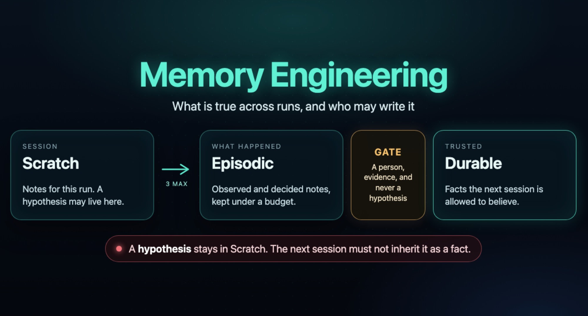

# Memory Engineering

<p align="center">
  
</p>

Context Engineering & Memory Engineering answer different questions, and the failure modes are different too.

Context engineering asks what fits in this prompt. It is the edit of one window: which files, tool results, and notes go in, what gets compressed, and what gets dropped so the model still attends to the right tokens.

Memory engineering asks what is true across runs, and who may write it. It is state with a policy: scratch notes for this session, an episodic log of what happened, durable facts that only a human or a verifier may promote, and a retrieval budget so the next context pack stays small. A fact can be correctly stored and still be the wrong thing to load. A window can be perfectly curated and still start from nothing tomorrow.

## Use it

Clone the repo and point one command at your project. No install.

```bash
git clone https://github.com/cobusgreyling/memory-engineering.git
cd memory-engineering

node memory.js init ../your-project
node memory.js write ../your-project "what you learned" --tag hypothesis
node memory.js promote ../your-project
node memory.js audit ../your-project --suggest
```

`write` appends Scratch. The default tag is `hypothesis`, so a guess cannot land as a fact. `promote` only prints the queue until you pass `--apply`. A hypothesis never moves to Durable.

```bash
node memory.js promote ../your-project --apply --to episodic
node memory.js promote ../your-project --apply --to durable --by "Your Name" --evidence "PR or path" --match "words"
```

Read a finished case without running anything: [examples/morning-after](examples/morning-after/README.md). The pass/fail list is [the memory test](docs/memory-test.md).

```bash
node memory.js --help
```

<p align="center">
  <a href="https://github.com/cobusgreyling/memory-engineering/stargazers"></a>
  <a href="./LICENSE"></a>
</p>

> **Stop re-explaining the repo. Design the memory. Get a score.**

Memory engineering is the practical discipline of giving AI coding agents **durable, trustworthy, budgeted recall** across sessions — without poisoning context or burning tokens.

Companion to:

| Layer | Repo | Unit |
|-------|------|------|
| Context | essays / runtime | One inference window |
| Harness | [harness-foundry](https://github.com/cobusgreyling/harness-foundry) | One agent run |
| **Memory** | **this repo** | What persists *between* runs |
| Loop | [loop-engineering](https://github.com/cobusgreyling/loop-engineering) | What keeps prompting over time |
| Fleet | [fleet-engineering](https://github.com/cobusgreyling/fleet-engineering) | Populations of agents |

## Start here (pick your pain)

| Symptom | Start with |
|---------|------------|
| Agent forgets decisions overnight | [Session Scratchpad](patterns/session-scratchpad.md) |
| “We already decided X” fights | [Project Episodic Log](patterns/project-episodic-log.md) |
| Wrong facts keep getting reloaded | [Durable Facts Store](patterns/durable-facts-store.md) |
| Context window bloated by history | [Retrieval Budget](patterns/retrieval-budget.md) |
| Stale / poisoned memory | [Memory Hygiene Loop](patterns/memory-hygiene-loop.md) |
| Already running loops | [docs/with-loop.md](docs/with-loop.md) |

Unsure? [Pattern picker](docs/pattern-picker.md) · [Quickstart](docs/QUICKSTART.md)

## Why this matters

Loop engineering designs the *system that prompts*. Memory engineering designs **what that system is allowed to remember**.

Without it:

- Every morning is a cold start
- Agents re-litigate settled decisions
- Long `STATE.md` files become untrusted sludge
- Token bills climb while quality falls

With it:

- Explicit memory tiers (scratch → episodic → durable)
- Write / recall / hygiene skills with verification
- A **Memory Ready** score (M0–M3) you can CI-gate
- Same house style as loop/fleet: patterns, starters, `init` + `audit`

## The four memory tiers

| Tier | Lifetime | Trust | Example |
|------|----------|-------|---------|
| **Scratch** | This session | Low | Working notes, open questions |
| **Episodic** | Days–weeks | Medium | What happened, decisions, handoffs |
| **Durable facts** | Until revoked | High | Stack, owners, invariants, “never do X” |
| **Retrieved** | Per inference | Variable | Chunks pulled under a budget |

Rules of thumb:

1. **Scratch is cheap to write, expensive to promote.**
2. **Durable facts need a human or verifier gate.**
3. **Retrieval without a budget is just context spam.**
4. **Hygiene is a loop** — memory rots.

## Contents

- [Quickstart (5 min)](docs/QUICKSTART.md)
- [Concepts](docs/concepts.md)
- [Memory Ready score](docs/memory-ready-score.md)
- [Maturity model (M0–M3)](docs/maturity-model.md)
- [Patterns](patterns/README.md)
- [CLI surface](docs/cli-surface.md)
- [Anti-patterns](docs/anti-patterns.md)
- [Operating memory](docs/operating-memory.md)
- [Memory test](docs/memory-test.md)
- [With loop / fleet](docs/with-loop.md)
- [Morning-after example](examples/morning-after/README.md)
- [Starters](starters/)
- [Stories](stories/) — start with [the poisoned durable fact](stories/poisoned-durable-fact.md)

## Getting started (5 minutes)

```bash
# 1. Scaffold memory spine + skills
node memory.js init ../your-project --pattern session-scratchpad --tool grok

# 2. Score readiness
node memory.js audit ../your-project --suggest

# 3. Week one: write scratch. Promote observed notes to episodic.
#    Leave durable for a person.
node memory.js write ../your-project "login failed on CI job 8841" --tag observed
node memory.js promote ../your-project --apply --to episodic
```

Artifacts created:

| File | Role |
|------|------|
| `MEMORY.md` | Posture: tiers, write policy, hygiene cadence |
| `MEMORY-STATE.md` | Live catalog of what is remembered |
| `memory-budget.md` | Token / entry caps |
| `memory-constraints.md` | What must never be stored |
| `memory-run-log.md` | Append-only ops log |
| `skills/` | recall / write / hygiene / verifier skill stubs |

## CLI surface

| Command | Job |
|---------|-----|
| `node memory.js init` | Scaffold pattern + templates + skills |
| `node memory.js write` | Append a Scratch bullet |
| `node memory.js promote` | Show or apply the promotion gate |
| `node memory.js audit` | Memory Ready score + suggestions |
| *(planned)* `memory-compact` | Summarize episodic under budget |
| *(planned)* `memory-mcp-server` | MCP tools: recall / write / list / hygiene |

Full flags: [docs/cli-surface.md](docs/cli-surface.md)

## Memory Ready (preview)

```
Memory Ready: 54/100  ·  M1 structured

OK   MEMORY.md present
OK   MEMORY-STATE.md present
OK   write + recall skills
WARN no hygiene skill
WARN no memory-budget.md
→ node tools/memory-init/cli.js . --pattern memory-hygiene-loop
```

See [docs/memory-ready-score.md](docs/memory-ready-score.md).

## Stack diagram

```
Model  →  Context pack  →  Memory tiers  →  Loop  →  Fleet
          (this turn)      (across turns)   (time)   (population)
```

## Contributing

See [CONTRIBUTING.md](CONTRIBUTING.md). Pattern PRs welcome — use `templates/pattern-template.md` and register in `patterns/registry.yaml`.

## Sources

[resources/sources.md](resources/sources.md)

## License

MIT — [LICENSE](LICENSE)
